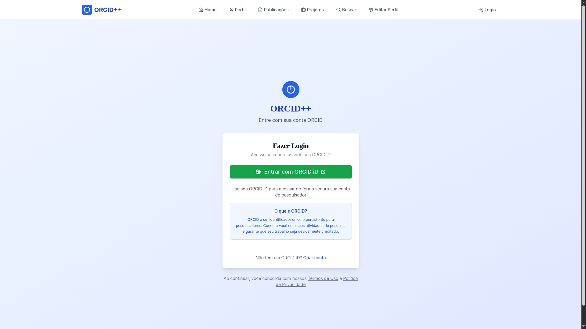
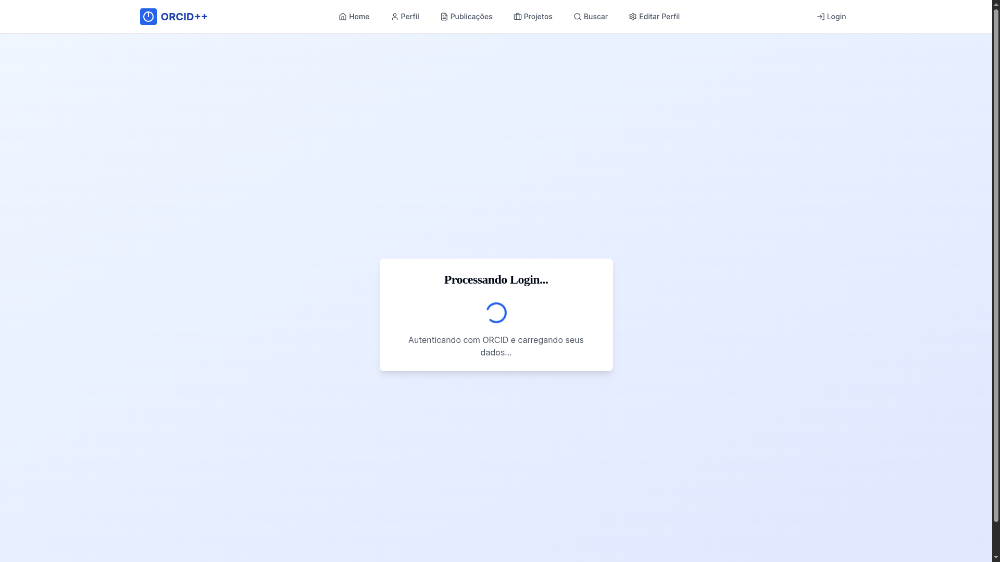
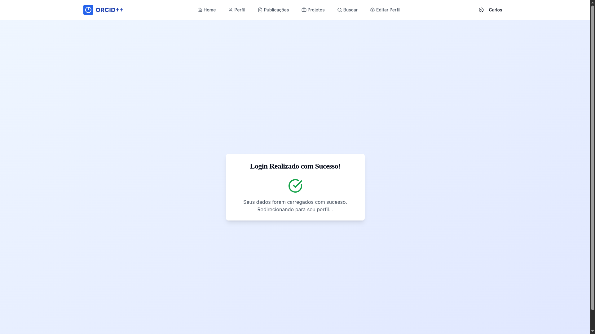
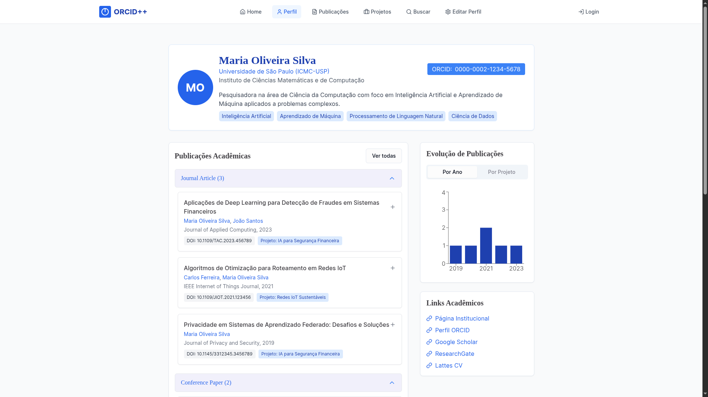
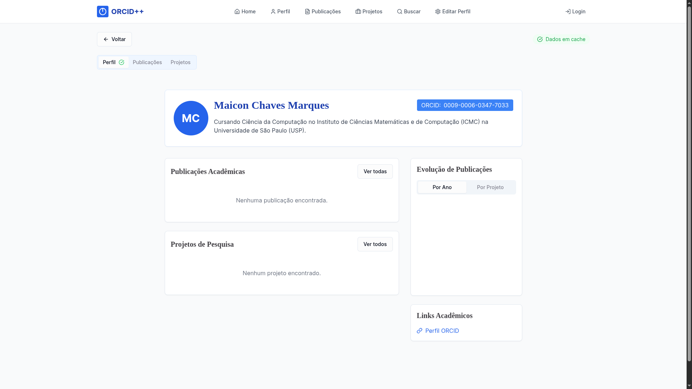
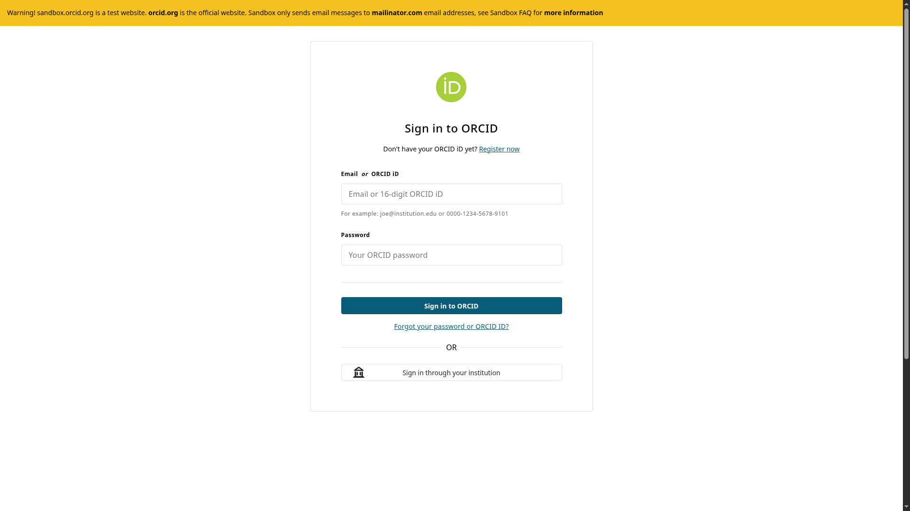
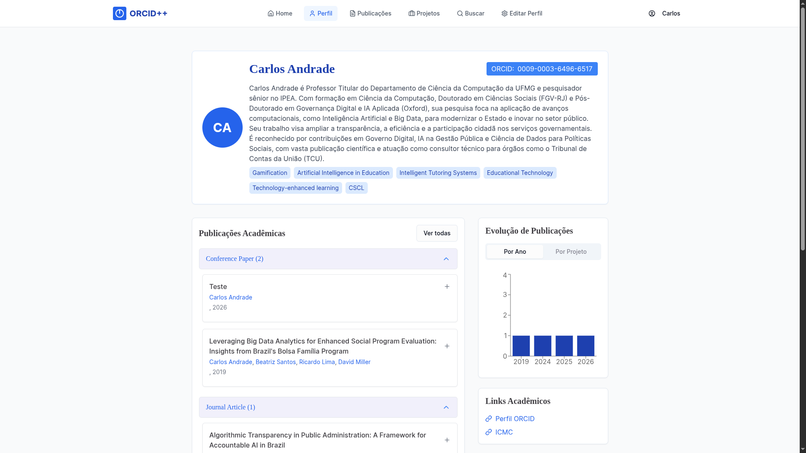

# ORCID++

**ORCID++** é uma aplicação web desenvolvida para expandir e aprimorar a plataforma [ORCID](https://orcid.org/), integrando sua API pública para oferecer uma experiência de uso mais completa e intuitiva a pesquisadores acadêmicos.

**Equipe:** Maicon Chaves Marques, Karl Cruz Altenhofen, Rodrigo de Freitas Lima

🎥 [Vídeo de apresentação](https://www.youtube.com/watch?v=DNMllZGG8_s)

---

## Sobre o projeto

O ORCID é amplamente utilizado por pesquisadores para registrar e divulgar sua produção científica, mas apresenta limitações relevantes em termos de usabilidade, visualização de dados e gerenciamento de produção. O ORCID++ foi construído para endereçar essas lacunas, adicionando funcionalidades que a plataforma original não oferece.

O sistema permite que pesquisadores autentiquem-se via OAuth 2.0, importem seus dados diretamente do ORCID e gerenciem sua produção científica — publicações, projetos, identificadores e links — em uma interface moderna e responsiva. Visitantes podem navegar por perfis públicos, explorar publicações e projetos, e visualizar estatísticas de produção por meio de gráficos interativos.

O projeto foi integralmente planejado e executado no **modelo cascata**, passando pelas fases de levantamento de requisitos (com entrevistas junto a pesquisadores da USP como stakeholders), projeto de sistema com diagramas UML, implementação e testes automatizados.

---

## Funcionalidades

- Autenticação via OAuth 2.0 integrada ao ORCID
- Criação e edição de perfil de pesquisador com associação ao ORCID iD
- Registro e edição de publicações com suporte a DOI, ISBN e outros identificadores padrão
- Criação e gerenciamento de projetos de pesquisa
- Vinculação de publicações a projetos
- Gráficos de evolução de publicações por ano e por projeto
- Busca de pesquisadores por nome, instituição e área de pesquisa
- Adição de links externos a publicações (preprints, repositórios, páginas institucionais)
- Visualização de perfis de outros pesquisadores com importação de dados via API do ORCID
- Sincronização com dados públicos do ORCID

---

## Telas

### Tela inicial


Ponto de entrada do sistema. Apresenta acesso às funcionalidades principais: busca de pesquisadores, navegação por publicações e projetos, e login.

### Login com ORCID



A autenticação é realizada via OAuth 2.0 diretamente com o ORCID. Ao clicar em "Entrar com ORCID", o usuário é redirecionado para a página de autorização do ORCID e, após conceder acesso, retorna ao sistema autenticado.

### Processando autenticação



Durante o callback OAuth, o sistema realiza a troca do código de autorização pelo token de acesso, consulta os dados do perfil via API do ORCID e os persiste no banco de dados local.

### Autenticação concluída



Com o token validado e o perfil sincronizado, o pesquisador é redirecionado para seu painel, onde pode visualizar e gerenciar toda sua produção.

### Perfil do pesquisador



A página de perfil centraliza as informações do pesquisador: afiliação institucional, áreas de pesquisa, publicações agrupadas por tipo, projetos vinculados, links acadêmicos externos e gráficos de evolução de produção por ano e por projeto.

### Busca de pesquisadores



O módulo de busca permite encontrar pesquisadores por nome, instituição ou área de atuação. Cada resultado exibe um resumo do perfil com acesso ao detalhamento completo.

### Identificador ORCID



O pesquisador pode associar seu ORCID iD ao perfil do ORCID++, habilitando a importação automática de publicações e a sincronização com a plataforma oficial.

### Testes



Os testes automatizados foram desenvolvidos com **Jest**, cobrindo os endpoints da camada de acesso ao banco de dados. Os testes utilizam uma base de dados temporária e isolada, garantindo que os dados de produção não sejam afetados. Testes manuais de sistema e usabilidade foram conduzidos pelos membros da equipe em múltiplos dispositivos e navegadores.

---

## Arquitetura e modelagem

O projeto foi modelado com diagramas UML produzidos com [PlantUML](https://plantuml.com), disponíveis no diretório `./PlantUML`:

- **Diagrama de casos de uso** — atores: pesquisador adicionando informações, pesquisador procurando informações e administrador
- **Diagrama de classes** — modelagem das entidades `Pesquisador`, `Publicacao`, `Projeto` e seus relacionamentos, filtros e componentes de página
- **Diagramas de atividades** — 12 fluxos cobertos, incluindo adicionar/editar produção intelectual, associar ORCID ID, verificar e atualizar dados do ORCID, criar e gerenciar perfil, buscar produção acadêmica e visualizar estatísticas
- **Diagramas de sequência** — fluxos de login OAuth, edição de perfil, busca e associação de identificador

A documentação completa está no diretório `./Documentação`.

---

## Stack

| Camada     | Tecnologias                                                  |
|------------|--------------------------------------------------------------|
| Frontend   | React, TypeScript, Vite, Tailwind CSS, shadcn/ui, Recharts   |
| Backend    | Node.js, Express                                             |
| Banco      | PostgreSQL                                                   |
| Auth       | OAuth 2.0 (ORCID)                                            |
| Testes     | Jest                                                         |
| Diagramas  | PlantUML                                                     |

---

## Instalação

### Requisitos

- [Node.js](https://nodejs.org/pt)
- [ngrok](https://ngrok.com/)
- [PostgreSQL](https://www.postgresql.org/)

📹 [Tutorial de instalação em vídeo (sem áudio)](https://drive.google.com/drive/u/0/folders/19mPU2FWb8A6NGkguvRUObAKiln0zITuS)

### 1. Clonar o repositório e instalar dependências

```bash
git clone https://github.com/EngSoft2025/orcid-project-clube-de-regatas-do-flamengo
cd orcid-project-clube-de-regatas-do-flamengo
```

Frontend:
```bash
cd ORCID++
npm i
```

Backend:
```bash
cd servidor/app
npm i
cd ../..
```

### 2. Inicializar o frontend

```bash
npm run dev
```

Será exibida uma lista de URLs. A URL do site é qualquer uma que não seja `localhost`.

### 3. Inicializar o ngrok

Em um novo terminal:
```bash
ngrok http [PORTA_DA_URL]
```

`[PORTA_DA_URL]` é a porta obtida na URL do passo anterior.

### 4. Configurar o banco de dados

No PostgreSQL, crie uma base de dados e inicialize-a com o script em `BD/create_tables.sql`.

### 5. Configurar variáveis de ambiente

No diretório raiz, crie `.env`:
```
VITE_ORCID_REDIRECT_URL="[URL_DO_NGROK]/login/callback"
```

No diretório `ORCID++/servidor/app`, crie `.env`:
```
PORT=3000
NODE_ENV=production
DB_HOST=[NOME_DO_HOST_DA_BD]
DB_PORT=[PORTA_DA_BD]
DB_USER=[USUARIO_DA_BD]
DB_PASSWORD=[SENHA_DA_BD]
DB_NAME=[NOME_DA_BD]

ORCID_CLIENT_ID=APP-GVPBMVHOEBR3RKKI
ORCID_CLIENT_SECRET=627be347-8fb5-4f90-976b-d18ecdbf6eb4

ORCID_API_BASE_URL=https://pub.sandbox.orcid.org/v3.0
ORCID_TOKEN_URL=https://sandbox.orcid.org/oauth/token

ALLOWED_ORIGINS=http://localhost:3000,http://localhost:8080
```

### 6. Configurar o Redirect URI no ORCID

Acesse [orcid.org](https://orcid.org) → Sign In → Developer Tools. Em "Redirect URIs", adicione:
```
[URL_DO_NGROK]/login/callback
```

### 7. Inicializar o backend

Em um novo terminal:
```bash
cd ORCID++/servidor/app
node server.js
```

Com os três terminais ativos (frontend, backend e ngrok), acesse `[URL_DO_NGROK]` no navegador.

---

## Testes unitários

```bash
cd ORCID++/servidor/app
npm test server.test.js
```

Os testes cobrem a camada de acesso ao banco de dados e utilizam uma base temporária, sem interferir nos dados de produção.
